<p align="center"></p>

<h1 align="center">Pip</h1>

<p align="center">
  <b>A tiny assistant that lives in a black island at the top of your Mac's screen,<br>
  and answers Claude Code's permission prompts for you, right there.</b>
</p>

<p align="center">
  <a href="https://github.com/frazz1234/pip-island/releases/latest"></a>
  <a href="https://github.com/frazz1234/pip-island/releases"></a>
  
</p>

<p align="center">
  <a href="https://github.com/frazz1234/pip-island/releases/latest/download/Pip.dmg">
    
  </a>
</p>

<p align="center">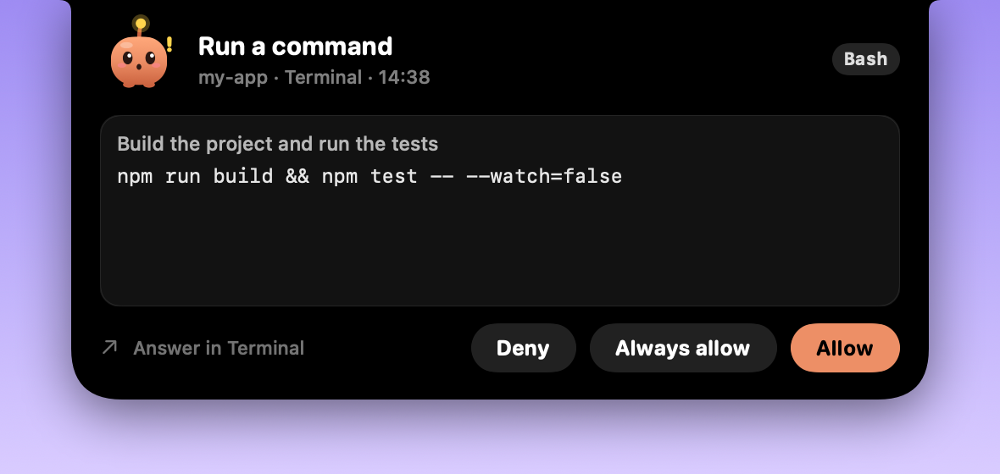</p>

---

## Contents

- [What Pip does](#what-pip-does)
- [A tour of Pip](#a-tour-of-pip)
  - [Claude asks, Pip pops open](#claude-asks-pip-pops-open)
  - [Pip in the notch](#pip-in-the-notch)
  - [The Pip tab](#the-pip-tab)
  - [The dashboard](#the-dashboard)
  - [The wheel](#the-wheel)
  - [The file wheel](#the-file-wheel)
- [Download and install](#download-and-install)
  - [Option 1: one line in Terminal](#option-1-one-line-in-terminal-fastest)
  - [Option 2: the DMG](#option-2-the-dmg)
  - [Where to find the app on GitHub](#where-to-find-the-app-on-github)
  - ["Pip can't be opened"](#pip-cant-be-opened)
- [Connect Pip to Claude Code](#connect-pip-to-claude-code)
- [Codex](#codex)
- [Away mode (Claude on your phone)](#away-mode-claude-on-your-phone)
- [Calendar](#calendar)
- [Settings](#settings)
- [Updates](#updates)
- [Uninstall](#uninstall)
- [FAQ](#faq)

---

## What Pip does

- 🟠 **Claude asks → Pip pops open.** Allow, Always allow, Deny, or *Answer in Claude* to use Claude's own prompt.
  Works with Claude Code in any terminal and in the Claude app's Code tab, and with OpenAI Codex
  (CLI, IDE extension and the ChatGPT desktop app).
- 🎵 **Hover the island** for music (Apple Music / Spotify), your next events, the weather, your battery and a volume slider.
- 🔊 **Press the volume keys** and Pip shows the level on a 16-step bar (drag it, or tap the speaker to mute).
- 🎯 **The wheel.** Press **⌃⌥Space** for a pie menu under the mouse with your apps, files, websites, commands and Pip's own switches.
- 🗂️ **Drag a file, hold Shift.** A file wheel pops up to convert, compress, resize, rotate, merge or lock it.
- 📋 **Pip tab** lists your Claude sessions: working, waiting, needs your OK, done.
- 📱 **Away mode.** One switch lets the Claude app on your phone chat with your sessions and approve requests while you're out.
- 🔄 **Updates itself.** Once a day Pip checks this repo's latest release and installs it.

---

## A tour of Pip

### Claude asks, Pip pops open

When Claude Code (or Codex) wants to run a command or change a file, Pip opens with the details and your choices.
You don't have to switch back to the terminal.

<table>
<tr>
<td align="center" width="50%"><br><sub><b>Run a command</b>: you see the exact command and why Claude wants it</sub></td>
<td align="center" width="50%">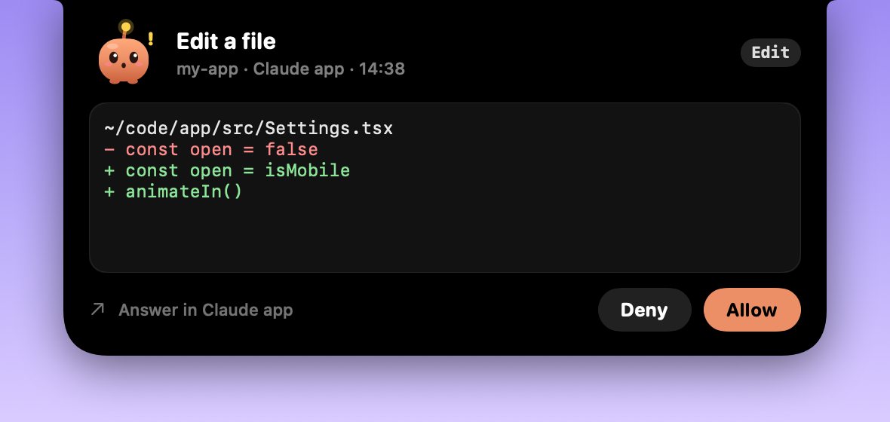<br><sub><b>Edit a file</b>: the change is shown as a diff before you approve it</sub></td>
</tr>
</table>

- **Allow** lets this one action through.
- **Always allow** lets this kind of action through from now on, without asking again.
- **Deny** blocks it, and Claude carries on without it.
- **Answer in Terminal / Claude app** (bottom left) sends you to Claude's own prompt, if you'd rather answer there.
- Each request shows the project, where it came from (Terminal, Claude app…) and the time.

### Pip in the notch

<table>
<tr>
<td align="center" width="40%"><br><sub><b>Resting</b>: Pip sits quietly next to the notch</sub></td>
<td align="center" width="60%">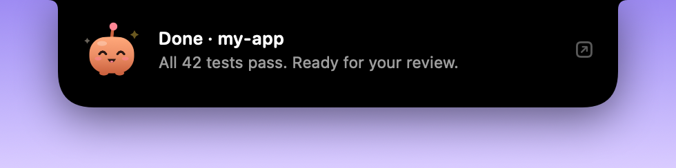<br><sub><b>Done</b>: a short notice when Claude finishes a task</sub></td>
</tr>
</table>

Most of the time Pip stays small. It grows only when something needs your attention, then shrinks back.

### The Pip tab

<p align="center">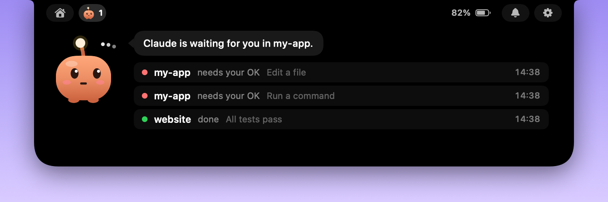</p>

Every Claude session in one list: **working**, **waiting**, **needs your OK** (red dot) or **done** (green dot).
Pip tells you which project is waiting for you, and what each session is asking for.

### The dashboard

Hover over the island to open it.

<p align="center">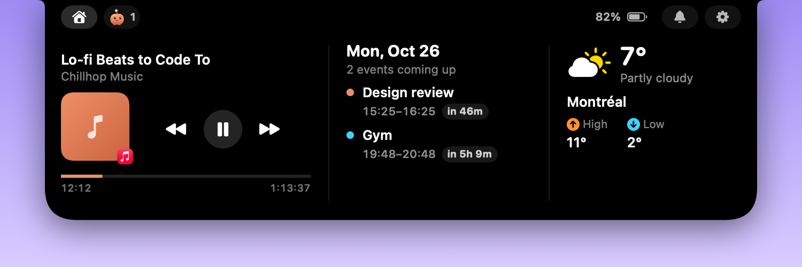</p>

- **Music:** what's playing in Apple Music or Spotify, with artwork, progress and play / pause / skip.
- **Calendar:** today's next events and how long until each one starts.
- **Weather:** temperature, conditions, and today's high and low where you are.
- **Top bar:** switch between the dashboard and the Pip tab, see your battery, and open settings with the gear.

<details>
<summary>When nothing is playing</summary>
<p align="center">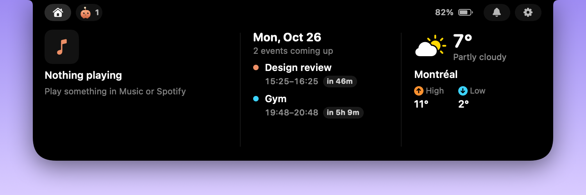</p>
</details>

### The wheel

Press **⌃⌥Space** and a pie menu opens right under your mouse. It's your launcher for the things you open all day.

<table>
<tr>
<td align="center">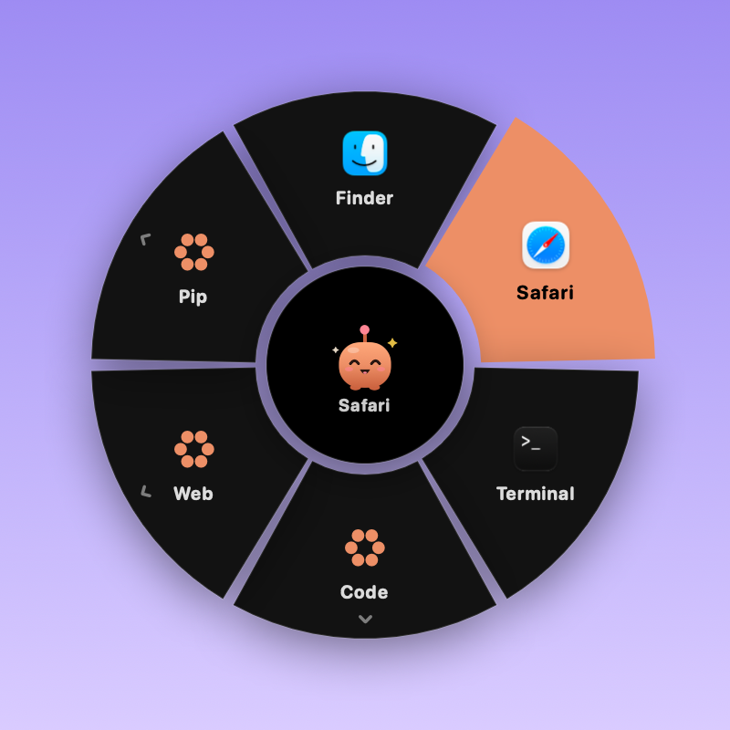<br><sub>Your apps and rings, under the mouse</sub></td>
<td align="center">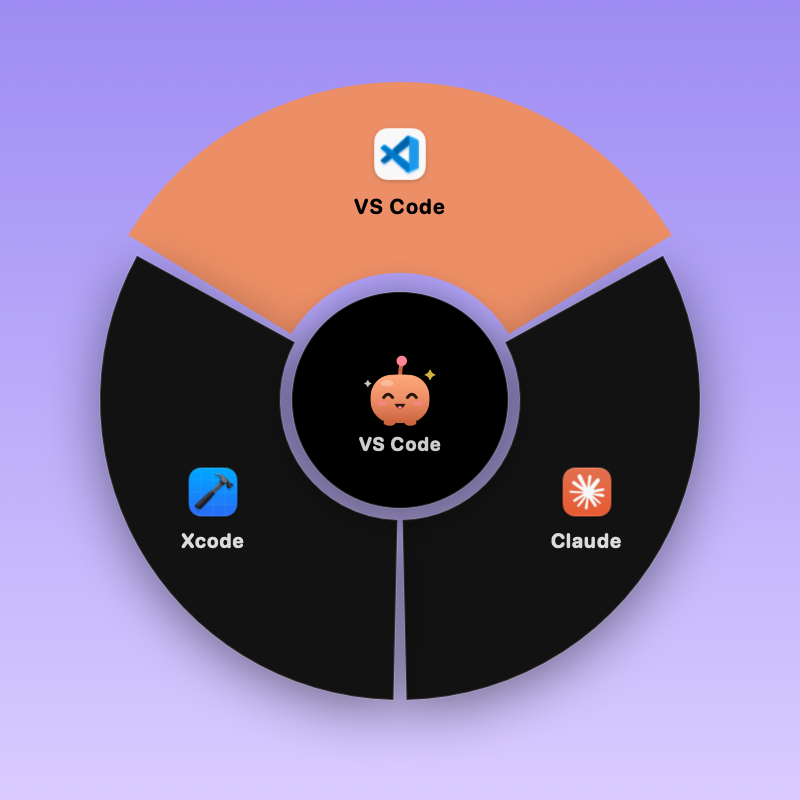<br><sub>A ring opens in place (here: Code)</sub></td>
</tr>
<tr>
<td align="center">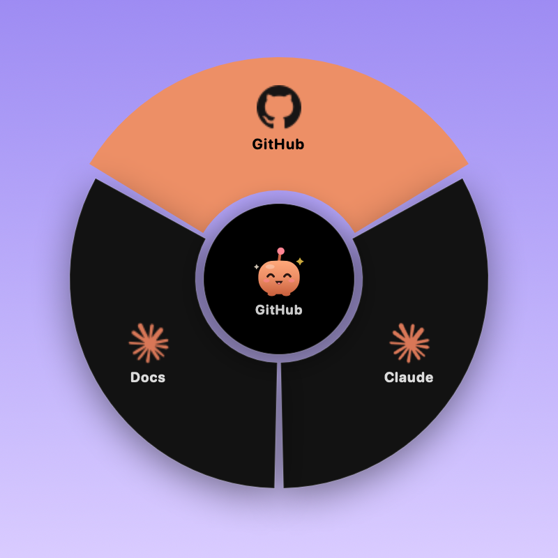<br><sub>Websites get their own icons</sub></td>
<td align="center">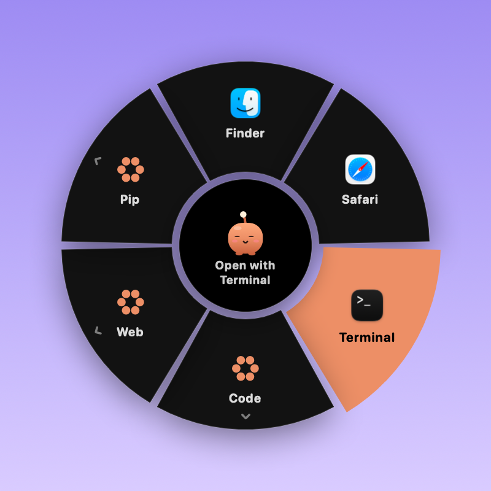<br><sub>Drop a file on an app to open it there</sub></td>
</tr>
</table>

- **What a slice can be:** an app, a file or folder, a website, a shell command, a Pip switch (Do Not Disturb,
  Focus, Away mode, Remind me, Settings), or a **ring**: a slice that opens another wheel, as deep as you like.
  Up to 8 slices per ring.
- **Pick with the mouse or the keyboard:** hover and click, press the slice's number, or use the arrows and Return.
  Click the centre, right-click or press Esc to go back a ring (or close the wheel).
- **Drop files on it:** drag a file onto an app slice to open it with that app, or onto a ring to step inside.
- **Make it yours:** Settings → **Wheel** has an editor with a live mini wheel. Add apps, files, websites, commands,
  Pip switches or new rings, rename them, move them around. You can change the shortcut there too.
- The first wheel is built from apps you already have: Finder, Safari, Terminal, a Code ring, a Web ring and a Pip ring.

### The file wheel

Start dragging a file (from Finder, the desktop, anywhere), then press **Shift** while still holding the mouse button.
A wheel of file tools pops up under the file. Drop the file on a slice and you're done.

<table>
<tr>
<td align="center">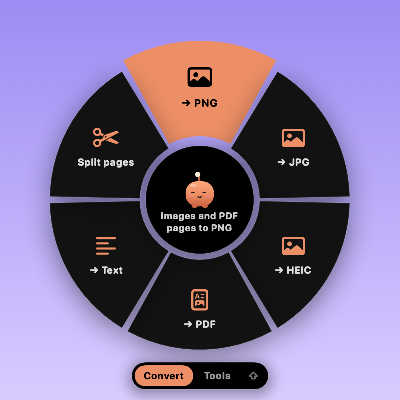<br><sub><b>Convert</b>: PNG, JPG, HEIC, PDF, Text, Split pages</sub></td>
<td align="center">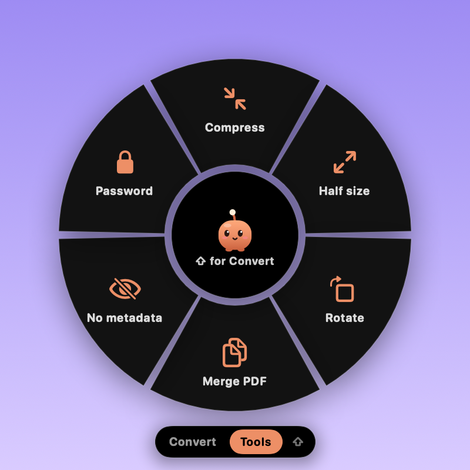<br><sub><b>Tools</b>: Compress, Half size, Rotate, Merge PDF, No metadata, Password</sub></td>
</tr>
</table>

- It opens on **Convert**. Tap **Shift** again (mouse still held) to flip to **Tools** and back.
- **Convert:** images and PDF pages to PNG or JPG, images to HEIC, images or text to PDF,
  a PDF's text to a .txt file, a PDF split into one file per page.
- **Tools:** compress JPG, HEIC, PNG or PDF, halve an image's size, rotate images or PDF pages, merge several PDFs,
  strip EXIF / GPS / PDF info, lock a PDF with a password.
- Drop several files at once to run the tool on all of them.
- Results are saved as new files next to the original ("photo small.jpg", "doc page 2.pdf"). **The original is never changed.**
- Prefer another key? Settings → **Wheel** → **Key while dragging**: Shift, Option or Control.

---

## Download and install

> **Requires macOS 14 (Sonoma) or later.**

This repository only hosts Pip's **builds**. The app is the `Pip.dmg` file attached to each
[release](https://github.com/frazz1234/pip-island/releases). There are two ways to install it. Pick one.

### Option 1: one line in Terminal (fastest)

Open **Terminal** (press `⌘ Space`, type *Terminal*, press Enter), then paste:

```bash
curl -fsSL https://raw.githubusercontent.com/frazz1234/pip-island/main/scripts/get-pip.sh | bash
```

<p align="center">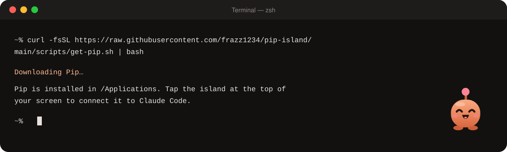</p>

What the [script](scripts/get-pip.sh) does:

1. Downloads the latest `Pip.dmg` from this repo's releases.
2. Quits Pip if it's already running, so this also works for reinstalls.
3. Copies `Pip.app` into `/Applications`, or `~/Applications` if you can't write to `/Applications`.
4. Removes the macOS "downloaded from the internet" flag, so **you won't get the security warning**.
5. Opens Pip.

### Option 2: the DMG

<p align="center">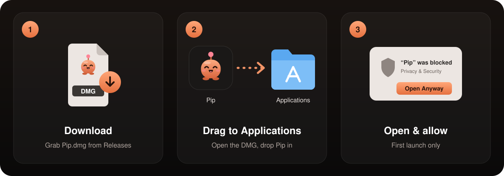</p>

1. **Download:** click **[Download Pip.dmg](https://github.com/frazz1234/pip-island/releases/latest/download/Pip.dmg)**.
   This link always gives you the newest version.
2. **Drag to Applications:** open `Pip.dmg` from your Downloads folder and drag **Pip** onto the **Applications** folder.
3. **Open it:** launch Pip from Applications. The first time, macOS will block it. See
   ["Pip can't be opened"](#pip-cant-be-opened) below.
4. Eject the DMG (right-click it in Finder → *Eject*). You can delete the `.dmg` file afterwards.

### Where to find the app on GitHub

If you'd rather click through GitHub yourself, or want an older version:

<p align="center">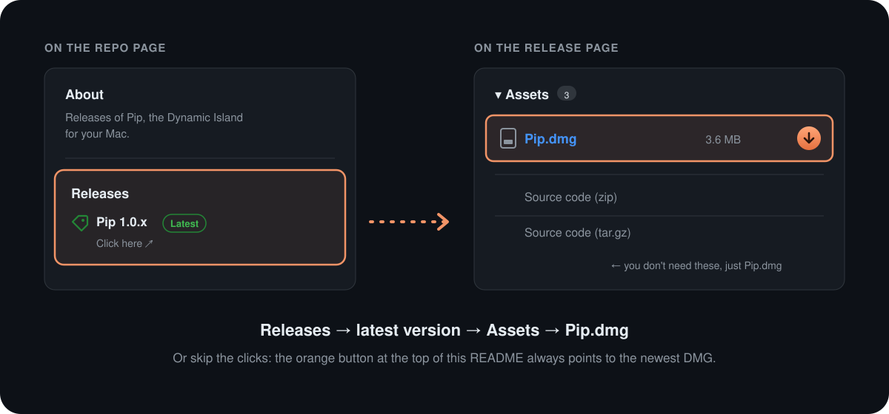</p>

1. On this repo's main page, look at the **right sidebar** and click **Releases**, or the version
   marked **Latest**. On a phone, Releases is further down the page.
2. On the release page, scroll down to **Assets**.
3. Click **`Pip.dmg`** to download it.
   **Source code (zip)** and **Source code (tar.gz)** are added by GitHub automatically. You don't need them.

All versions are listed at **[github.com/frazz1234/pip-island/releases](https://github.com/frazz1234/pip-island/releases)**.

### "Pip can't be opened"

Pip isn't notarized by Apple, so the first time you open the DMG version, macOS blocks it. To allow it:

1. Open **System Settings** → **Privacy & Security**.
2. Scroll down to the **Security** section. You'll see *"Pip" was blocked to protect your Mac.*
3. Click **Open Anyway**, then confirm with your password or Touch ID.

You only need to do this once. The Terminal install (option 1) skips this step.

---

## Connect Pip to Claude Code

1. Look at the **top centre of your screen**. Pip lives in the black island there.
2. **Tap the island** and choose **Connect to Claude Code**.
3. That's it. **New** Claude sessions now ask through Pip.

Behind the scenes, Pip adds its hooks to `~/.claude/settings.json` and saves a backup next to it first.
If Pip isn't running, Claude asks in the terminal as usual, so nothing breaks.

---

## Codex

Right-click the island → **Connected to Codex**. Pip adds its hooks to `~/.codex/hooks.json` (backup saved first).

Codex skips new hooks until you approve them, so open Codex once and type `/hooks` to trust Pip's.
Codex approvals then pop up in Pip just like Claude's (Allow / Deny; Codex has no "Always allow" for hooks).
Needs Codex CLI 0.124 or newer.

---

## Away mode (Claude on your phone)

1. Install the Claude app on your phone and sign in with the same account (Pro, Max, Team or Enterprise).
2. Hover the island and click the **phone icon** (or right-click → **Away Mode**).
3. Every Claude Code session you start from then on (terminal, VS Code, the Claude app's Code tab) shows up in the
   Claude app → **Code**, where you can send messages and approve requests. In a session that was already open,
   type `/rc`. Scan the QR code on Pip's tab to jump straight in.
4. Optional: right-click → **Let Phone Start Sessions in a Folder…** to also start new sessions from your phone in that project.

While Away mode is on, Pip keeps your Mac from going to sleep when idle and sends approvals to your phone instead of the island.
Closing a laptop's lid still puts it to sleep. For push alerts, run `/config` in Claude Code and turn on **Push when actions required**.

<details>
<summary>More details: how it works, Codex, first-time setup</summary>

- Pip turns on Claude Code's `remoteControlAtStartup` setting, and puts your old value back when you turn Away mode off.
- The chats are Claude's own Remote Control sessions, so their history lives in your Claude account
  (Claude app on your phone and claude.ai/code).
- **Codex too:** if the Codex CLI is installed, Away mode also starts Codex's remote control (still experimental at OpenAI),
  so the ChatGPT app on your phone can drive Codex on this Mac. Pair once with right-click → **Pair Phone With Codex…**,
  or in the ChatGPT desktop app under Settings → Connections.
- The first time, Claude may need a one-time OK (log in, trust the folder, enable Remote Control). Pip then shows
  **Fix in Terminal**, which opens Terminal with the right command so you can answer it once.
- Team and Enterprise plans need an admin to turn on Remote Control for Claude Code.
</details>

---

## Calendar

Pip reads every calendar in the macOS Calendar app (iCloud, Google, Exchange…).
For Outlook / Microsoft 365, add the account in **System Settings → Internet Accounts → Microsoft Exchange**.

---

## Settings

Right-click the island (or click the ⚙️ gear) for:

| | |
|---|---|
| **Connected to Claude Code** / **Connected to Codex** | Turn each connection on or off |
| **Do Not Disturb** | Keep Pip quiet; Claude asks in the terminal as usual |
| **Sounds** | Turn Pip's sounds on or off |
| **Tell Me When Claude Finishes** | Show a notice when a session is done |
| **Open at Login** | Start Pip with your Mac |
| **Away Mode** / **Away Folder…** | Use Claude from your phone |
| **Open the Wheel** | Open the pie menu |
| **Check for Updates…** / **Update Automatically** | Control updates |
| **Quit** | Close Pip |

---

## Updates

Pip checks this repository **once a day** and installs new releases by itself. You don't need to do anything.

To update right away: right-click the island → **Check for Updates…**, or run the Terminal command from
[option 1](#option-1-one-line-in-terminal-fastest) again.

---

## Uninstall

1. Right-click the island and turn off **Connected to Claude Code** (and **Connected to Codex** if you use it),
   so Claude goes back to asking in the terminal.
2. Choose **Quit**.
3. Drag **Pip** from **Applications** to the **Trash**.

---

## FAQ

<details>
<summary><b>Which Macs does Pip work on?</b></summary>

Any Mac running **macOS 14 Sonoma or later**.
</details>

<details>
<summary><b>What happens if Pip isn't running?</b></summary>

Claude Code asks for permission in the terminal as usual. Nothing breaks.
</details>

<details>
<summary><b>Is my data sent anywhere?</b></summary>

Claude's requests go from Claude Code to Pip on your own Mac (`127.0.0.1`), and your answer goes straight back.
Requests coming from a web browser are refused.
</details>

<details>
<summary><b>Where is the source code?</b></summary>

This repository only contains releases (the built app) and the install script.
</details>

<details>
<summary><b>The download link gives me a 404.</b></summary>

A new release may still be uploading. Wait a minute and try again, or pick a version from the
[releases page](https://github.com/frazz1234/pip-island/releases).
</details>

<p align="center"><br><br><sub>Made with 🧡 for people who live in Claude Code.</sub></p>
