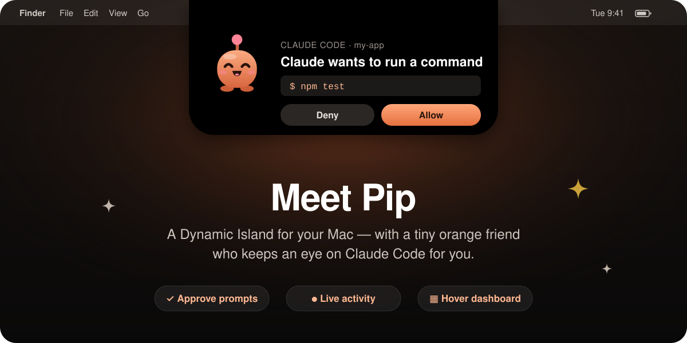
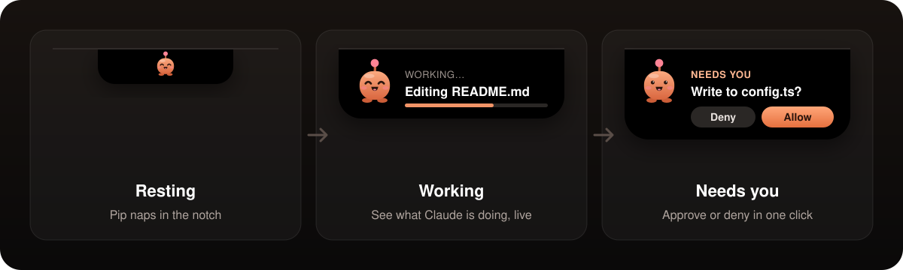
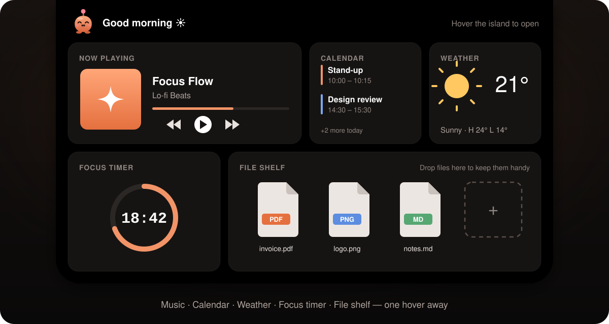

<p align="center"></p>

<h1 align="center">Pip</h1>

<p align="center">
  <b>A Dynamic Island for your Mac, with a small orange mascot that keeps an eye on Claude Code for you.</b>
</p>

<p align="center">
  <a href="https://github.com/frazz1234/pip-island/releases/latest"></a>
  <a href="https://github.com/frazz1234/pip-island/releases"></a>
  
</p>

<p align="center">
  <a href="https://github.com/frazz1234/pip-island/releases/latest/download/Pip.dmg">
    
  </a>
</p>

<p align="center"></p>

---

## Contents

- [What Pip does](#what-pip-does)
- [Download and install](#download-and-install)
  - [Option 1: one line in Terminal](#option-1-one-line-in-terminal-fastest)
  - [Option 2: the DMG](#option-2-the-dmg)
  - [Where to find the app on GitHub](#where-to-find-the-app-on-github)
  - ["Pip can't be opened"](#pip-cant-be-opened)
- [First launch](#first-launch)
- [Updates](#updates)
- [Uninstall](#uninstall)
- [FAQ](#faq)

---

## What Pip does

Pip lives in the notch at the top of your screen. It stays small when nothing is happening
and expands when Claude Code needs you.

<p align="center"></p>

| | |
|---|---|
| 🟠 **Answer permission prompts** | When Claude Code asks to run a command or edit a file, the question shows up in the island. Click **Allow** or **Deny** without switching back to the terminal. |
| 👀 **See what Claude is doing** | Pip shows what Claude is working on, so you can stay in another app and still know what's going on. |
| 🧭 **Hover dashboard** | Move your mouse over the island to open a small dashboard. |

### The hover dashboard

<p align="center"></p>

- 🎵 **Music**: what's playing right now.
- 📅 **Calendar**: your upcoming events.
- ☀️ **Weather**: the weather where you are.
- ⏱️ **Focus timer**: start a focus session from the notch.
- 📂 **File shelf**: drop files on it to keep them close by, then drag them out when you need them.

> **Note:** the pictures in this README are illustrations. The real app may look a little different.

---

## Download and install

> **Requires macOS 14 (Sonoma) or later.**

This repository only hosts Pip's **builds**. You won't find source code here. The app itself
is the `Pip.dmg` file attached to each [release](https://github.com/frazz1234/pip-island/releases).

There are two ways to install it. Pick one.

### Option 1: one line in Terminal (fastest)

Open **Terminal** (press `⌘ Space`, type *Terminal*, press Enter), then paste:

```bash
curl -fsSL https://raw.githubusercontent.com/frazz1234/pip-island/main/scripts/get-pip.sh | bash
```

<p align="center"></p>

What the [script](scripts/get-pip.sh) does:

1. Downloads the latest `Pip.dmg` from this repo's releases.
2. Quits Pip if it's already running, so this also works for reinstalls.
3. Copies `Pip.app` into `/Applications`, or `~/Applications` if you can't write to `/Applications`.
4. Removes the macOS "downloaded from the internet" flag, so you won't see the security prompt.
5. Opens Pip.

### Option 2: the DMG

<p align="center"></p>

1. **Download:** click **[Download Pip.dmg](https://github.com/frazz1234/pip-island/releases/latest/download/Pip.dmg)**.
   This link always gives you the newest version.
2. **Drag to Applications:** open `Pip.dmg` from your Downloads folder and drag **Pip** onto
   the **Applications** folder.
3. **Open it:** launch Pip from Applications or Launchpad. If macOS blocks it the first time,
   see ["Pip can't be opened"](#pip-cant-be-opened) below.
4. Eject the DMG (right-click it in Finder → *Eject*). You can delete the `.dmg` file afterwards.

### Where to find the app on GitHub

If you'd rather click through GitHub yourself, or want an older version:

<p align="center"></p>

1. On this repo's main page, look at the **right sidebar** and click **Releases**, or the version
   marked **Latest**. On a phone, Releases is further down the page.
2. On the release page, scroll down to **Assets**.
3. Click **`Pip.dmg`** to download it.
   **Source code (zip)** and **Source code (tar.gz)** are added by GitHub automatically.
   You don't need them.

All versions are listed at **[github.com/frazz1234/pip-island/releases](https://github.com/frazz1234/pip-island/releases)**.

### "Pip can't be opened"

The first time you open an app downloaded from a browser, macOS may stop it with a warning. To allow Pip:

1. Open **System Settings** → **Privacy & Security**.
2. Scroll down to the **Security** section. You'll see *"Pip" was blocked to protect your Mac.*
3. Click **Open Anyway**, then confirm with your password or Touch ID.

You only need to do this once. The Terminal install (option 1) skips this step.

---

## First launch

1. Look at the **top centre of your screen**. Pip is in the island around the notch.
2. **Tap the island** to connect Pip to Claude Code.
3. Use Claude Code as usual. Permission prompts and progress now appear in the island.

---

## Updates

Pip checks this repository **once a day** and updates itself when a new release is out.
You don't need to do anything.

To update right away, run the Terminal command from [option 1](#option-1-one-line-in-terminal-fastest)
again, or download the DMG again and replace the old app.

---

## Uninstall

1. Quit Pip.
2. Drag **Pip** from **Applications** to the **Trash**.

---

## FAQ

<details>
<summary><b>Which Macs does Pip work on?</b></summary>

Any Mac running **macOS 14 Sonoma or later**.
</details>

<details>
<summary><b>Do I need Claude Code?</b></summary>

Pip is built around [Claude Code](https://claude.com/claude-code): the permission prompts and
live activity come from your Claude Code sessions.
</details>

<details>
<summary><b>Where is the source code?</b></summary>

This repository only contains releases (the built app) and the install script.
</details>

<details>
<summary><b>The download link gives me a 404.</b></summary>

A new release may be uploading. Wait a minute and try again, or pick a version from the
[releases page](https://github.com/frazz1234/pip-island/releases).
</details>

<p align="center"><br><br><sub>Made with 🧡 for people who live in Claude Code.</sub></p>
